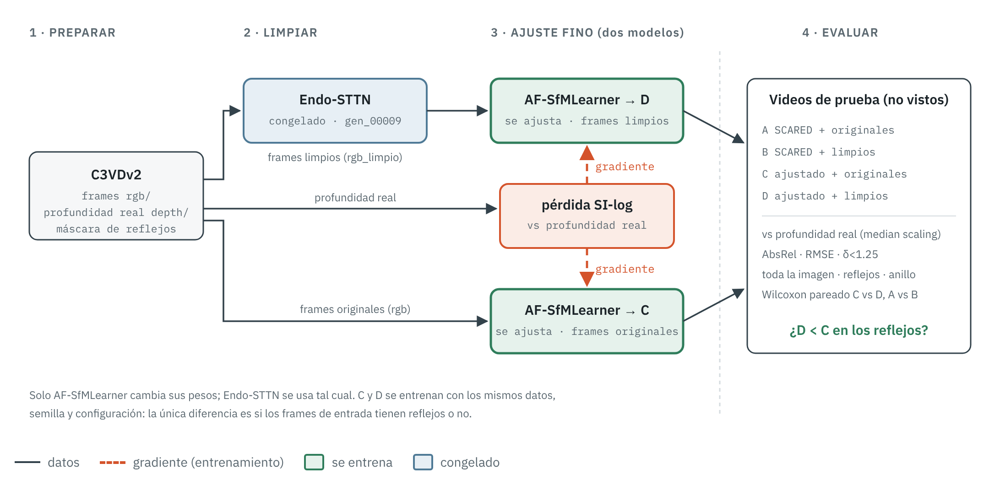

# Avance 2 · Endo-STTN limpia los frames para mejorar la estimación de profundidad

**Equipo 19** · Eliminación de reflejos especulares en video endoscópico · Reporte en PDF: [`Avance2__Equipo19.pdf`](Avance2__Equipo19.pdf)

> **Cómo revisar este avance en 5 minutos**
> 1. Lee el [Resumen](#resumen) y mira la [figura del método](#4-metodología).
> 2. La justificación está en [3.4 Por qué limpiar los frames debería ayudar al estimador](#34-por-qué-limpiar-los-frames-debería-ayudar-al-estimador).
> 3. Revisa el diseño de la [evaluación](#45-evaluación) y el estado de los [resultados](#5-experimentos-y-resultados).
> 4. Código: [`codigo/`](../codigo/) (cuatro pasos, un script cada uno). Endo-STTN se usa sin modificar.
> 5. Para verificar sin datos ni pesos: `python codigo/prueba_rapida.py`.

**Contenido:** [Resumen](#resumen) · [1. Objetivo e hipótesis](#1-objetivo-e-hipótesis) · [2. Contexto](#2-contexto) ·
[3. Marco teórico](#3-marco-teórico) · [4. Metodología](#4-metodología) · [5. Experimentos y resultados](#5-experimentos-y-resultados) ·
[6. Discusión y limitaciones](#6-discusión-y-limitaciones) · [7. Siguientes pasos](#7-siguientes-pasos) ·
[8. Cómo reproducir](#8-cómo-reproducir) · [9. Referencias](#9-referencias)

## Resumen

Los reflejos especulares ocultan el tejido y engañan a los estimadores de profundidad monocular. En este avance,
**Endo-STTN** [1] (congelado) borra los reflejos de los videos de **C3VDv2** [9] y con esos frames limpios se hace un
**ajuste fino supervisado** de **AF-SfMLearner** [4] usando la profundidad real del dataset. Para aislar el efecto de
la limpieza se entrena un segundo estimador idéntico con los frames originales, y ambos se comparan contra la
profundidad real en videos no vistos, en toda la imagen y dentro de los reflejos. El flujo completo está
implementado y probado con datos sintéticos; en una primera prueba con C3VDv2, el estimador ajustado con frames limpios
tuvo 23 % menos error relativo dentro de los reflejos que el ajustado con frames originales (resultado preliminar).

## 1. Objetivo e hipótesis

**Objetivo.** Mejorar la estimación de profundidad monocular en colonoscopía usando Endo-STTN para eliminar los
reflejos especulares de los frames con los que se entrena y se usa el estimador.

**Hipótesis.** Un estimador ajustado con frames limpios (D) tiene menor error de profundidad que uno ajustado con
frames originales (C), sobre todo en las zonas que tenían reflejos, sin empeorar en el resto de la imagen.

## 2. Contexto

El Equipo 52 [7] evaluó varios estimadores de profundidad en SCARED y mostró que el preprocesamiento de la imagen
cambia la profundidad estimada. Aquí damos un paso más: no solo se limpia la imagen antes de estimar, sino que el
estimador **aprende** con frames limpios, y se usa un dataset con profundidad real por frame (C3VDv2) para medir el
efecto con precisión.

## 3. Marco teórico

### 3.1 Reflejos especulares en endoscopía
El endoscopio ilumina con una fuente casi coaxial a la cámara, y la mucosa es húmeda y brillante. Por eso aparecen
**reflejos especulares**: zonas saturadas, casi blancas, que cambian de posición con cada movimiento de la cámara.
Ocultan la textura del tejido y no corresponden a su superficie, lo que afecta a los algoritmos que dependen de la
apariencia: correspondencias, flujo óptico, movimiento de cámara y profundidad [1].

### 3.2 Inpainting de video: STTN y Endo-STTN
El *inpainting* rellena una región marcada por una máscara con contenido plausible. En video, lo que falta en un frame
suele verse en otros, porque el reflejo se mueve y el tejido no. **STTN** [2] lo aprovecha con un transformer
espacio-temporal: divide los frames en parches de varias escalas y usa atención para buscar, en frames vecinos y
lejanos, los parches que mejor completan la máscara. **Endo-STTN** [1] lo adapta a endoscopía entrenando con una
*pseudo ground truth*: desplaza la máscara de reflejos a una zona sana del mismo frame, de modo que el modelo aprende a
rellenar tejido cuyo aspecto real sí se conoce. Aquí se usa su modelo preentrenado, sin modificarlo.

### 3.3 Estimación de profundidad monocular
Una red de profundidad monocular predice, a partir de una sola imagen, un mapa de **disparidad** (inversa de la
profundidad). Como en endoscopía casi no hay profundidad real, estos modelos suelen entrenarse de forma
**autosupervisada** [3]: aprenden a reconstruir un frame a partir del siguiente, y el error fotométrico es la señal de
entrenamiento. La profundidad resultante tiene **escala ambigua**: se conoce la forma relativa, no los milímetros.
**AF-SfMLearner** [4] añade un módulo de *appearance flow* que compensa los cambios de brillo entre frames y se
entrenó en SCARED [5] (tejido porcino ex vivo).

### 3.4 Por qué limpiar los frames debería ayudar al estimador
En endoscopía la luz sale de la punta del endoscopio, así que la intensidad del tejido depende de su distancia y
orientación (*shading*): es una de las pistas que una red monocular usa para inferir la forma. Un reflejo especular
rompe esa relación: es la zona más brillante, pero no la más cercana, y carece de textura. Si el estimador se entrena y
se usa con reflejos, puede aprender asociaciones falsas en esas zonas. Al quitarlos antes, la apariencia vuelve a ser
coherente con la geometría, tanto al entrenar como al usar el modelo.

Además, AF-SfMLearner se entrenó en SCARED y C3VDv2 es otro dominio (modelos de silicona de colon, otra cámara y
otra iluminación). El **ajuste fino supervisado** con la profundidad real de C3VDv2 adapta el estimador al nuevo
dominio. Para que la comparación sea justa, los modelos C y D reciben exactamente el mismo ajuste fino; lo único que
cambia es si los frames tienen reflejos.

**Pérdida.** Como la profundidad monocular no tiene escala absoluta, se usa la pérdida *scale-invariant log* [6] en
su forma totalmente invariante a escala, calculada por imagen sobre los píxeles con profundidad real:

```math
\mathcal{L}_{SI} = \frac{1}{n}\sum_{p} g_p^2 - \Big(\frac{1}{n}\sum_{p} g_p\Big)^2,
\qquad g_p = \log \hat d_p - \log d_p
```

donde $\hat d$ es la profundidad predicha y $d$ la real. Es la varianza del error logarítmico: no cambia si toda la
predicción se multiplica por una constante, de modo que solo penaliza errores de forma.

**Métricas.** Antes de medir, cada predicción se escala por la mediana de la profundidad real (*median scaling*,
calculado con toda la imagen). Después se calculan las métricas estándar: AbsRel $`= \mathrm{mean}(|\hat d - d|/d)`$,
SqRel, RMSE, RMSE log y $`\delta < 1.25`$ (fracción de píxeles con $`\max(\hat d/d, d/\hat d) < 1.25`$).

## 4. Metodología



### 4.1 Datos
| | |
|---|---|
| Dataset | C3VDv2 [9]: videos de colonoscopía sobre modelos de silicona, con profundidad real por frame (registro 2D-3D) |
| Preparación | 1 de cada 5 frames, hasta 300 por video, a 320×256 (resolución de AF-SfMLearner) |
| Profundidad | TIFF de 16 bits → mm (0–65535 = 0–100 mm); se verifica con `codigo/probar_formato.py` |
| Reflejos | Brillo ≥ 230, máscara dilatada 3 px |
| División **por video** | Prueba: `c1_ascending_t4_v3`, `c2_descending_t4_v3`, `c2_rectum_t1_v3`, `c1_ascending_t2_v3` · Validación: `c1_ascending_t3_v1`, `c2_descending_t3_v1` · Entrenamiento: el resto (sin `c1_full_*`, de 17–19 GB) |

### 4.2 Limpieza con Endo-STTN
Modelo preentrenado `gen_00009.pth`, sin entrenar. Inferencia oficial de Endo-STTN (frames vecinos cada 5 + frames de
referencia cada 10) a 288×288, por bloques de 60 frames. El relleno se reescala a 320×256 y se pega **solo dentro de
la máscara**: fuera de ella el frame no cambia.

### 4.3 Ajuste fino del estimador
| Parámetro | Valor |
|---|---|
| Punto de partida | AF-SfMLearner, pesos *End-to-end* (SCARED) |
| Pérdida | Scale-invariant log ($`\lambda = 1`$), píxeles con profundidad real |
| Optimizador | Adam; lr 1e-4 en el decoder, 1e-5 en el encoder |
| Lote / épocas | 8 / 15; se guarda la época con menor AbsRel de validación |
| Aumentos | Volteo horizontal; brillo ±10 % y desplazamiento ±0.05 |
| Modelos | **C**: frames originales · **D**: frames limpios (misma semilla y configuración) |

### 4.4 Modelos comparados
| Modelo | Pesos | Frames de prueba | Responde |
|---|---|---|---|
| A | AF-SfMLearner (SCARED) | originales | Línea base |
| B | AF-SfMLearner (SCARED) | limpios | ¿Limpiar ayuda sin reentrenar? |
| C | ajustado con originales | originales | Efecto del ajuste fino solo |
| D | ajustado con limpios | limpios | **Propuesta** |

### 4.5 Evaluación
En los videos de prueba, contra la profundidad real, en tres regiones: **toda la imagen**, **dentro de los reflejos**
y un **anillo** de 10 px alrededor. La comparación decisiva es **C vs. D** (solo cambia la limpieza), con una prueba de
Wilcoxon pareada por frame (H1: D tiene menor AbsRel). También se reporta A vs. B.

## 5. Experimentos y resultados

| | Experimento | Resultado |
|---|---|---|
| ✅ | Prueba de punta a punta con datos sintéticos (`codigo/prueba_rapida.py`) | Los 4 pasos corren; la limpieza no cambia ningún píxel fuera de la máscara |
| ✅ | Ajuste fino con datos sintéticos (6 épocas) | AbsRel de validación baja de 0.31 a 0.18: la pérdida y el entrenamiento funcionan |
| ✅ | AF-SfMLearner con pesos reales en la GPU de la laptop | Carga a 256×320; 0.32 GB de GPU |
| ✅ | Formato de la profundidad de C3VDv2 (`probar_formato.py`) | TIFF 16 bits, 0–100 mm; 65535 = saturado (sin dato) |
| ✅ | Preparación y limpieza de C3VDv2 (5 videos) | Endo-STTN no cambia ningún píxel fuera de los reflejos |
| ✅ | Ajuste fino C y D (15 épocas, semilla 0) | AbsRel de validación: C 0.156, D 0.154 |
| ✅ | **Prueba 1**: evaluación A–D en `c2_descending_t4_v3` | Ver [reporte de la Prueba 1](resultados/prueba_1/README.md) |
| ⬜ | Prueba 2: más videos de prueba, 3 semillas | *pendiente* |

**Prueba 1 · AbsRel en el video de prueba `c2_descending_t4_v3`** (26 frames, semilla 0)

| Modelo | Toda la imagen ↓ | Reflejos ↓ | Anillo ↓ |
|---|---|---|---|
| A · SCARED + originales | 0.404 | 0.753 | 0.476 |
| B · SCARED + limpios | 0.399 | 0.744 | 0.457 |
| C · ajustado + originales | 0.089 | 0.111 | 0.104 |
| **D · ajustado + limpios** | **0.078** | **0.085** | **0.075** |

D tiene menos error que C en toda la imagen (−12 %, Wilcoxon p < 0.001) y sobre todo en los reflejos (−23 %, p = 0.015)
y a su alrededor (−28 %). Limpiar sin reentrenar (B vs A) no cambia significativamente el error. Resultado preliminar:
un solo video de prueba, que comparte textura con el entrenamiento, y una semilla.
Detalle, figuras e interpretación: [**reporte de la Prueba 1**](resultados/prueba_1/README.md).

## 6. Discusión y limitaciones

- **Dominio de Endo-STTN.** Se entrenó con videos reales (HyperKvasir); C3VDv2 son modelos de silicona. Si el relleno
  no se parece al tejido del dataset, el estimador D aprende de imágenes con artefactos.
- **Máscaras por umbral.** Pueden incluir zonas claras que no son reflejos y omitir reflejos tenues.
- **Resolución.** Se trabaja a 320×256; los reflejos muy pequeños pueden perderse al reducir la imagen.
- **Profundidad real.** Viene de registrar el video con el modelo 3D y puede tener errores de registro.
- **Datos de prueba.** Los videos de prueba comparten modelo de colon y texturas con los de entrenamiento; la
  generalización a pacientes reales no se evalúa aquí.
- **Variabilidad.** Con una sola semilla, una diferencia pequeña entre C y D puede ser azar; se recomiendan 3 semillas.

## 7. Siguientes pasos

1. Correr el flujo con C3VDv2 y completar la tabla de resultados.
2. Repetir C y D con 3 semillas y reportar media ± desviación.
3. Evaluar en un dataset distinto (por ejemplo SCARED) para medir generalización.
4. Probar otros estimadores (MonoIIT, el mejor en el estudio del Equipo 52 [7]).

## 8. Cómo reproducir

Instalación y pasos: [README principal](../README.md#cómo-correrlo). Notebooks:
[`notebooks/Equipo19_Avance2_local.ipynb`](notebooks/Equipo19_Avance2_local.ipynb) y
[`notebooks/Equipo19_Avance2_colab.ipynb`](notebooks/Equipo19_Avance2_colab.ipynb).

| Carpeta | Contenido |
|---|---|
| [`../codigo/`](../codigo/) | Los cuatro pasos y la prueba rápida |
| [`notebooks/`](notebooks/) | Flujo completo con figuras (local y Colab) |
| [`figuras/`](figuras/) | Diagrama del método |
| [`resultados/`](resultados/README.md) | Tablas de evaluación |

## 9. Referencias

1. R. Daher, F. Vasconcelos, D. Stoyanov. *A Temporal Learning Approach to Inpainting Endoscopic Specularities and Its Effect on Image Correspondence.* Medical Image Analysis, 2023. doi:10.1016/j.media.2023.102994
2. Y. Zeng, J. Fu, H. Chao. *Learning Joint Spatial-Temporal Transformations for Video Inpainting.* ECCV, 2020.
3. C. Godard, O. Mac Aodha, M. Firman, G. Brostow. *Digging Into Self-Supervised Monocular Depth Estimation* (Monodepth2). ICCV, 2019.
4. S. Shao et al. *Self-Supervised Monocular Depth and Ego-Motion Estimation in Endoscopy: Appearance Flow to the Rescue.* Medical Image Analysis, 2022.
5. M. Allan et al. *Stereo Correspondence and Reconstruction of Endoscopic Data Challenge* (SCARED). arXiv:2101.01133, 2021.
6. D. Eigen, C. Puhrsch, R. Fergus. *Depth Map Prediction from a Single Image using a Multi-Scale Deep Network.* NeurIPS, 2014.
7. Equipo 52, *La luz que opaca*: evaluación de estimadores de profundidad en SCARED. [github.com/jmtoral/proyecto_integrador_52](https://github.com/jmtoral/proyecto_integrador_52)
8. T. L. Bobrow et al. *Colonoscopy 3D Video Dataset with Paired Depth from 2D-3D Registration* (C3VD). Medical Image Analysis, 2023.
9. Golhar et al. *C3VDv2*, 2025. Extensión de C3VD [8].

---

*Este avance se elaboró con apoyo de Claude (Anthropic) para código, documentación y diagramas.
Todos los integrantes revisaron y validaron el contenido, y el equipo es responsable de él.*
