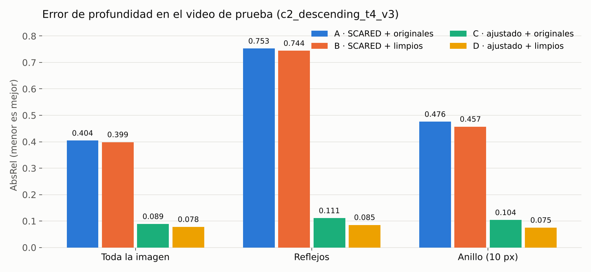
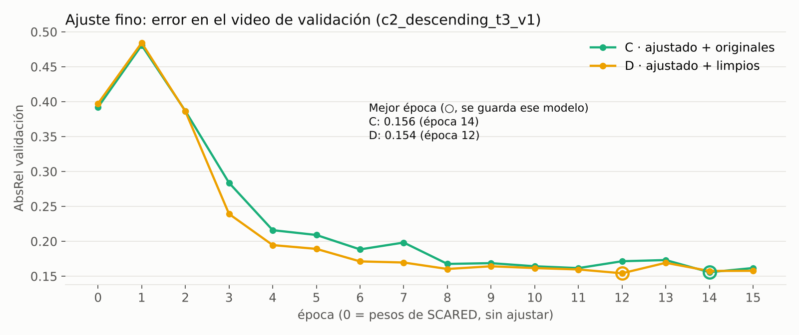

# Avance 2 · Resultados · Prueba 1

**Equipo 19** · Primera corrida completa del pipeline con datos reales de C3VDv2
(Endo-STTN limpia los frames → ajuste fino de AF-SfMLearner → evaluación contra la profundidad real).

> **Resumen.** El ajuste fino con la profundidad real de C3VDv2 reduce el error de AF-SfMLearner de
> AbsRel 0.40 a 0.09 en el video de prueba. Entrenar y evaluar con frames limpiados por Endo-STTN (modelo D)
> da menos error que hacerlo con frames originales (modelo C): **−12 % en toda la imagen, −23 % dentro de los
> reflejos y −28 % alrededor de ellos**, con diferencias significativas por frame (Wilcoxon p = 0.015 en
> reflejos, p < 0.001 en la imagen). Es un resultado preliminar: un solo video de prueba, 26 frames y una semilla.

## 1. Configuración

| | |
|---|---|
| Fecha / entorno | 11 de octubre de 2026 · Google Colab con GPU · notebook `Equipo19_Avance2_colab.ipynb` |
| Videos de entrenamiento | `c2_descending_t4_v1`, `c2_descending_t4_v2`, `c2_rectum_t1_v1` |
| Video de validación | `c2_descending_t3_v1` (elige la mejor época) |
| Video de prueba | `c2_descending_t4_v3` (26 frames evaluados) |
| Preparación | 1 de cada 5 frames, hasta 300 por video, 320×256; profundidad TIFF 16 bits → mm (0–100 mm; 0 y 65535 = sin dato) |
| Limpieza | Endo-STTN preentrenado (`gen_00009.pth`), sin entrenar; solo cambia los píxeles de reflejo |
| Ajuste fino | AF-SfMLearner (pesos *End-to-end*, SCARED) · pérdida scale-invariant log · Adam lr 1e-4 (decoder) / 1e-5 (encoder) · lote 8 · 15 épocas · semilla 0 |

## 2. Resultados principales

**AbsRel en el video de prueba** (menor es mejor; *median scaling* con toda la imagen)

| Modelo | Toda la imagen | Reflejos | Anillo (10 px) |
|---|---|---|---|
| A · SCARED + originales | 0.404 | 0.753 | 0.476 |
| B · SCARED + limpios | 0.399 | 0.744 | 0.457 |
| C · ajustado + originales | 0.089 | 0.111 | 0.104 |
| **D · ajustado + limpios** | **0.078** | **0.085** | **0.075** |
| Cambio de C a D | −12.4 % | −23.0 % | −27.8 % |

**Pruebas de Wilcoxon pareadas por frame** (H1: el segundo modelo tiene menor AbsRel)

| Comparación | Región | Frames | Mediana de la diferencia | p |
|---|---|---|---|---|
| C vs D | reflejos | 26 | 0.028 | **0.015** |
| C vs D | toda la imagen | 26 | 0.018 | **0.0005** |
| A vs B | reflejos | 26 | 0.002 | 0.134 |

**Curvas de validación del ajuste fino**

En validación, C y D terminan casi iguales (mejor AbsRel 0.156 y 0.154). D baja más rápido en las épocas 3–7.

## 3. Otras métricas

| Región | Modelo | AbsRel | SqRel | RMSE (mm) | RMSE log | δ < 1.25 |
|---|---|---|---|---|---|---|
| Toda la imagen | C | 0.089 | 0.334 | **3.67** | 0.112 | 0.950 |
| | D | **0.078** | **0.321** | 3.82 | **0.102** | **0.958** |
| Reflejos | C | 0.111 | 0.242 | 1.95 | 0.130 | **0.929** |
| | D | **0.085** | **0.202** | **1.71** | **0.110** | 0.910 |
| Anillo | C | 0.104 | 0.243 | 2.04 | 0.125 | 0.925 |
| | D | **0.075** | **0.176** | **1.72** | **0.101** | **0.931** |

Tabla completa (A–D, todas las regiones): [`evaluacion_resumen.md`](evaluacion_resumen.md).

## 4. Interpretación

1. **El ajuste fino es lo que más pesa.** Pasar de A a C reduce el AbsRel en toda la imagen un 78 % (0.404 → 0.089).
   AF-SfMLearner, entrenado en SCARED (tejido porcino), no se transfiere bien a C3VDv2 (modelos de silicona) sin adaptarlo.
2. **Limpiar los reflejos ayuda cuando el estimador aprende con frames limpios.** D mejora a C en casi todas las
   métricas, y la mejora es mayor justo donde están los reflejos y a su alrededor, que es lo que predice la hipótesis.
3. **Limpiar sin reentrenar casi no cambia nada.** B frente a A mejora solo 1–4 % y no es significativo (p = 0.13):
   el beneficio aparece cuando el estimador se entrena con el mismo tipo de imagen que recibe.
4. **No todas las métricas favorecen a D.** El RMSE en toda la imagen (3.82 vs 3.67 mm) y δ < 1.25 en reflejos
   (0.910 vs 0.929) son algo peores. D reduce el error relativo medio, pero no gana en todos los criterios.

## 5. Limitaciones de esta prueba

- **Un solo video de prueba y 26 frames.** Frames consecutivos están correlacionados, así que los valores de p
  son optimistas; la evidencia es preliminar.
- **Prueba y entrenamiento comparten textura** (t4 en `c2_descending_t4_v3` y en `t4_v1`, `t4_v2`), lo que
  favorece a los modelos ajustados (C y D por igual).
- **Una sola semilla.** No se sabe aún cuánto varía la diferencia C–D con otra inicialización del entrenamiento.
- **Pocos datos de entrenamiento** (3 videos de una misma región del colon y del recto).
- Las máscaras de reflejos se obtienen por umbral de brillo.

## 6. Siguientes pasos (Prueba 2)

1. Repetir C y D con semillas 1 y 2 y reportar media ± desviación.
2. Evaluar en más videos de prueba, incluyendo texturas no vistas al entrenar (p. ej. `c1_ascending_t4_v3`, `c2_rectum_t1_v3`).
3. Agregar videos de entrenamiento de otras secciones (`c1_ascending_*`).

## 7. Archivos

| Archivo | Contenido |
|---|---|
| [`evaluacion_resumen.md`](evaluacion_resumen.md) | Tablas completas A–D por región y pruebas de Wilcoxon (salida de `codigo/evaluar_profundidad.py`) |
| [`historial_C_rgb.json`](historial_C_rgb.json), [`historial_D_rgb_limpio.json`](historial_D_rgb_limpio.json) | AbsRel de validación por época y configuración de cada ajuste fino |
| `absrel_por_region.png`, `curvas_validacion.png` | Figuras de este reporte, generadas a partir de los archivos anteriores |
