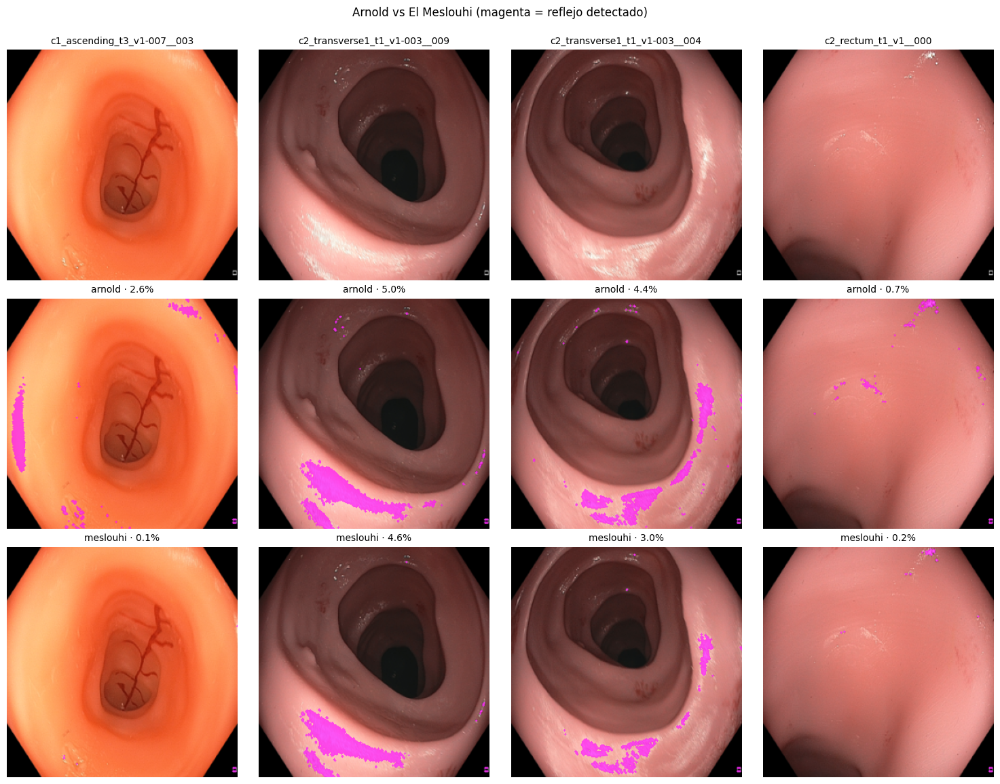
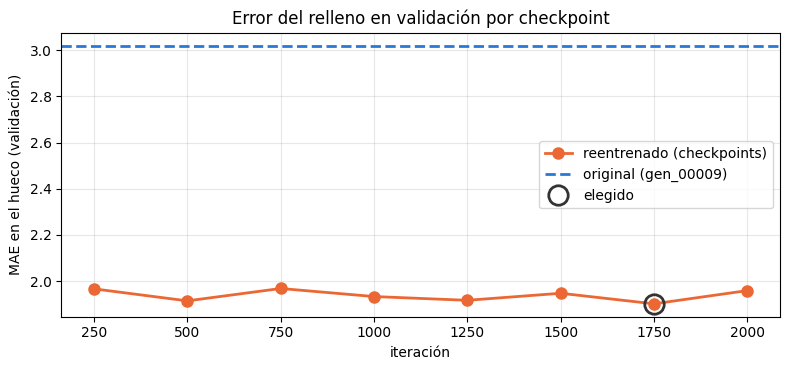
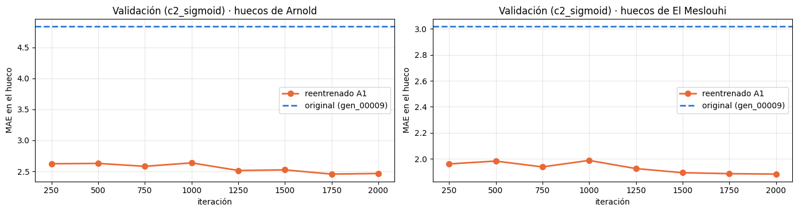
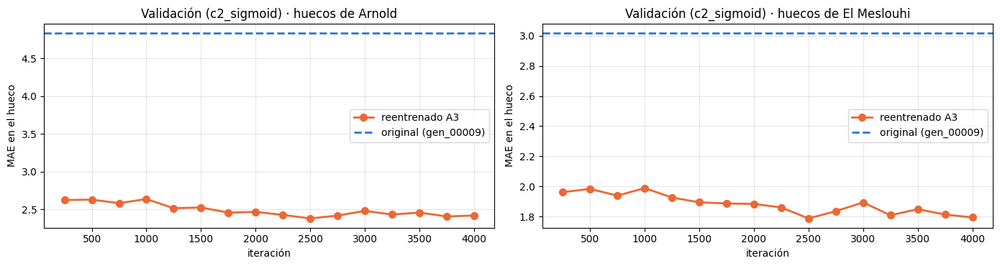
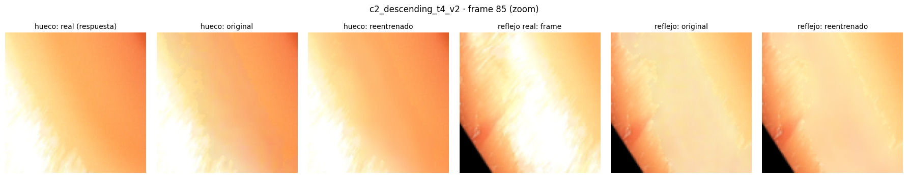

# Avance 4 · Comparación de máscaras

**Equipo 19** · Continúa el [Avance 3](../Avance3_ReEntrenar_Endo/README.md). Compara dos máscaras de reflejos
para reentrenar Endo-STTN con C3VDv2: **El Meslouhi et al. (2011)**, la de los autores de Endo-STTN (corridas 1 a 5,
Mario), y **Arnold et al. (2010)** (variantes A1 a A3, Juan).

> **Aclaración:** este avance se hizo con apoyo de herramientas de IA. Su uso, la contribución de cada integrante
> y las decisiones principales están en la [declaración de uso de IA](#8-declaración-de-uso-de-ia-y-contribución-del-equipo).

## Resumen

Con la misma configuración de entrenamiento (la de la corrida 4) y evaluadas sobre **los mismos huecos**, las dos
máscaras dan un Endo-STTN que rellena mucho mejor que el modelo publicado (de 29.5 a ~32.5–32.7 dB de PSNR). Arnold
queda **ligeramente por encima** de El Meslouhi con las dos semillas (+0.23 dB en promedio), pero la diferencia es del
orden de la variación entre semillas, así que **las dos máscaras se consideran equivalentes** para reentrenar.
Lo que sí cambia mucho el resultado es la configuración: qué videos entran al entrenamiento y la tasa de aprendizaje.
Entrenar el doble (4000 iteraciones, variante A3) mejora la validación pero **no** la prueba: 2000 iteraciones bastan.

| Prueba: `c2_descending_t4_v2` y `v3`, huecos de El Meslouhi | Responsable | PSNR (dB) ↑ | SSIM ↑ | MAE ↓ |
|---|---|---|---|---|
| Original (`gen_00009.pth`, sin reentrenar) | — | 29.51 | 0.826 | 6.66 |
| El Meslouhi · corrida 4 (semilla 2020) | Mario | 32.52 | 0.879 | 4.30 |
| El Meslouhi · corrida 5 (semilla 2021) | Mario | 32.43 | 0.876 | 4.37 |
| **Arnold · A1 (semilla 2020)** | Juan | **32.74** | **0.880** | **4.18** |
| **Arnold · A2 (semilla 2021)** | Juan | 32.67 | 0.879 | 4.25 |
| Arnold · A3 (semilla 2020, 4000 iteraciones) | Juan | 32.26 | 0.876 | 4.53 |

Todas mejoran al original con Wilcoxon pareado por frame p < 10⁻³⁹.

## 1. Contenido

| Carpeta | Archivo | Qué es |
|---|---|---|
| `resultados/meslouhi/corrida_1/` … `corrida_5/` | `notebook_ejecutado.ipynb` | Corridas 1 a 5 con El Meslouhi (Mario), con sus salidas |
| `resultados/arnold/A1/`, `A2/`, `A3/` | `Arnold_variacion_A?_Ejecutado.ipynb` | Variantes A1, A2 y A3 con Arnold (Juan), con sus salidas |
| `resultados/arnold/` | `Arnold_variaciones.ipynb` | Notebook de Colab para correr las variantes (A1, A2, A3), sin ejecutar |
| `resultados/arnold/` | `Prueba_Entrenamiento_con_Arnold_Ejecutado.ipynb` | Primera prueba con Arnold del Avance 3 (lr 1e-4, otra división) |
| `figuras/` | `*.png` | Figuras de este README, tomadas de los notebooks ejecutados |

Los notebooks de El Meslouhi son copias de las carpetas `corrida_1/` … `corrida_5/` de la raíz del repositorio, donde
están también sus resúmenes, configuraciones, métricas por frame y figuras, y el análisis de Mario en el
[README principal](../README.md). La prueba con Arnold del Avance 3 se conserva también en
`Avance3_ReEntrenar_Endo/resultados/`.

## 2. Cómo se compararon

Lo común a todas las corridas y variantes:
- Endo-STTN reentrenado desde los pesos publicados (`gen_00009.pth`) con su entrenamiento original
  (`Avance3_ReEntrenar_Endo/entrenar_endosttn.py`), frames de 288×288, todos los frames de cada video.
- **Mismos videos de prueba:** `c2_descending_t4_v2` y `c2_descending_t4_v3`, que ningún modelo vio al entrenar.
- Métricas en el **hueco desplazado** (*pseudo ground truth*): la máscara de reflejos movida 50 px sobre tejido sano,
  cuyo color real sí se conoce. PSNR y SSIM: mayor es mejor; MAE (0-255): menor es mejor.

**Los mismos huecos para las dos máscaras.** El hueco desplazado sale de la propia máscara de reflejos: con Arnold
los huecos de prueba son otros (más grandes) y el mismo modelo original da 29.09 dB en lugar de 29.51 dB. Por eso
las variantes con Arnold se evalúan **dos veces**: con sus propios huecos y con los de El Meslouhi
(`evaluar_endosttn.py --mascara-eval meslouhi`). La segunda es la que se compara con las corridas de Mario.
Comprobación: con esos huecos, el modelo original da exactamente 29.51 dB en A1 y en A2, igual que en las corridas.

## 3. Corridas con El Meslouhi (Mario)

| Corrida | Entrenamiento | Validación | lr | Lote | Iteraciones | Semilla | GPU | Elegido | PSNR | SSIM | MAE |
|---|---|---|---|---|---|---|---|---|---|---|---|
| 1 | Solo rosa | `c1_ascending_t3_v1` | 1e-4 | 2 | 9 000 | 2020 | T4 | iter. 1000 | 27.18 | 0.808 | 8.68 |
| 2 | Con video naranja | `c2_sigmoid_t3_v2` | 1e-4 | 4 | 4 000 | 2020 | L4 | iter. 750 | 31.67 | 0.872 | 4.75 |
| 3 | Solo rosa | `c1_ascending_t3_v1` | 1e-4 | 4 | 2 000 | 2020 | L4 | iter. 1250 | 26.67 | 0.802 | 8.71 |
| **4** | Con video naranja | `c2_sigmoid_t3_v2` | **1e-5** | 4 | 2 000 | 2020 | L4 | iter. 1750 | **32.52** | **0.879** | **4.30** |
| 5 | Con video naranja | `c2_sigmoid_t3_v2` | 1e-5 | 4 | 2 000 | 2021 | L4 | iter. 2000 | 32.43 | 0.876 | 4.37 |

"Solo rosa": `c2_cecum`, `c2_rectum`, `c2_sigmoid`, `c2_transverse1`. "Con video naranja": cambia `c2_sigmoid` por
`c1_ascending`, el único video de entrenamiento del mismo color que la prueba.

1. **El color del entrenamiento es lo que más pesa.** Sin el video naranja (corridas 1 y 3) el reentrenado es
   **peor** que el original (p = 1) y rellena con tonos rosados sobre tejido naranja; con él (2, 4 y 5) es
   **mejor** (p < 10⁻²⁶). Ver la [figura de color](../figuras/color_entrenamiento_vs_prueba.png).
2. **lr 1e-5 es mejor que 1e-4** (corrida 4 contra 2): validación estable entre checkpoints y mejor prueba.
3. **El resultado se repite** con otra semilla (corrida 5: 32.43 contra 32.52 dB).
4. **Entrenar más no ayuda con lr 1e-4** (corrida 1): la validación empeora casi sin parar desde la iteración 1000.

## 4. Variantes con Arnold (Juan)

Misma configuración que la corrida 4 (lr 1e-5, lote 4, 2000 iteraciones, un checkpoint cada 250) y misma división
que la corrida 5, con la máscara de Arnold. GPU A100. A2 cambia la semilla; A3 continúa el entrenamiento de A1 desde la
iteración 2000 hasta la 4000 (sus checkpoints hasta la 2000 son los de A1).

| Variante | Semilla | Elegido (huecos Arnold / El Meslouhi) | Huecos de Arnold: PSNR · SSIM · MAE | Huecos de El Meslouhi: PSNR · SSIM · MAE |
|---|---|---|---|---|
| Original | — | — | 29.09 · 0.841 · 6.88 | 29.51 · 0.826 · 6.66 |
| **A1** | 2020 | iter. 1750 / 2000 | 32.46 · 0.908 · 3.97 | **32.74 · 0.880 · 4.18** |
| **A2** | 2021 | iter. 2000 / 2000 | 32.28 · 0.907 · 4.04 | 32.67 · 0.879 · 4.25 |
| A3 (4000 iteraciones) | 2020 | iter. 2500 / 2500 | 31.48 · 0.903 · 4.51 | 32.26 · 0.876 · 4.53 |

1. **Arnold también mejora claramente al original**, con sus huecos (+3.2 a +3.4 dB) y con los de El Meslouhi
   (+3.2 dB).
2. **Con los mismos huecos queda a la par de El Meslouhi**, un poco por encima: promedio de las dos semillas
   32.71 contra 32.47 dB de PSNR y 4.22 contra 4.34 de MAE.
3. **El resultado se repite** con otra semilla (A1 contra A2: 32.74 contra 32.67 dB).
4. **Entrenar más no ayuda (A3).** En A1 y A2 el mejor checkpoint con huecos de El Meslouhi era el último (iteración 2000), así que A3 siguió
   hasta la 4000. La validación sí mejora un poco (MAE con huecos de El Meslouhi: 1.88 en la iteración 2000, 1.79 en
   la 2500, y oscila entre 1.79 y 1.89 hasta la 4000), pero el checkpoint que elige (iteración 2500) rellena **peor**
   en prueba que el de A1: 32.26 contra 32.74 dB. Es decir, después de 2000 iteraciones el modelo se ajusta al video
   de validación (`c2_sigmoid`, rosa y con 0.7 % de reflejos) y no generaliza mejor al de prueba (`c2_descending`,
   naranja). Con un solo video de validación, elegir el checkpoint es ruidoso; 2000 iteraciones son suficientes.

## 5. Imágenes de referencia

**Máscaras.** Arnold (fila del medio) contra El Meslouhi (abajo) en 4 frames de entrenamiento; magenta = reflejo
detectado. Arnold marca más área y, en `c1_ascending` (primera columna), una franja de pared naranja que no es
reflejo (2.6 % contra 0.1 %). Aun así, el modelo entrenado con Arnold no rellena peor.

**Validación por checkpoint** (`c2_sigmoid_t3_v2`, MAE en el hueco; la línea punteada es el original).

| El Meslouhi · corrida 4 (Mario) | Arnold · A1 (Juan, huecos de Arnold y de El Meslouhi) |
|---|---|
|  |  |

Con los huecos de El Meslouhi, la validación de Arnold A1 (1.88 de MAE en la iteración 2000) y la de la corrida 4
(1.90 en la 1750) son prácticamente iguales. La de A2 está en
[`figuras/validacion_arnold_A2.png`](figuras/validacion_arnold_A2.png).

Arnold · A3 (Juan): la validación sigue bajando un poco después de la iteración 2000, pero la prueba no mejora
(sección 4).

**Relleno en un frame de prueba** (`c2_descending_t4_v2`, frame 85, zoom): hueco desplazado (se conoce la respuesta)
y reflejo real, original contra reentrenado.

El Meslouhi · corrida 4 (Mario):

Arnold · A1 (Juan): *pendiente.* El notebook `Arnold_variaciones.ipynb` ya tiene la celda que genera esta figura en el
mismo frame (`relleno_A1.png`); falta correrla (ver sección 6).

## 6. Pendientes

| Tarea | Responsable | Cómo |
|---|---|---|
| Figura de relleno de A1 y A2 en el frame 85 | Juan | En `Arnold_variaciones.ipynb`, poner `VARIANTE = "A1"` y `CORRER_PREPARAR`, `CORRER_ENTRENAR` y `CORRER_EVALUAR` en `False`, ejecutar todo y subir `relleno_A1.png` a `figuras/`. Igual con A2 |
| Subir los resultados de A1, A2 y A3 | Juan | Copiar `arnold_variaciones/A?/resultados/` de Drive (`resumen.md`, `prueba_por_frame.csv`, `comparacion.csv`) a `resultados/arnold/A?/` |
| Prueba pareada Arnold contra El Meslouhi | Javier | Con los `prueba_por_frame.csv` (huecos de El Meslouhi) de A1 y de la corrida 4: Wilcoxon por frame para saber si la ventaja de Arnold es significativa |
| Confirmar los videos de entrenamiento | Juan, Mario | Los ZIPs de entrenamiento de Juan traen sufijo (`-007`, `-002`, `-003`); comprobar que son los mismos videos que usó Mario (validación y prueba sí lo son: el original da los mismos números) |

## 7. Notas importantes

- **La prueba es pequeña:** un solo segmento (`c2_descending_t4`, 2 videos). Los valores p de Wilcoxon exageran la
  certeza porque los frames de un video están correlacionados.
- **El pseudo ground truth premia copiar reflejos:** el hueco desplazado puede caer sobre otro reflejo cercano, y
  el modelo que lo reproduce obtiene mejor métrica. Hay que revisar también las figuras, no solo los números.
- **La validación no es comparable entre corridas con distinto video de validación** (1 y 3 contra las demás). La
  prueba sí: los mismos dos videos en todas.
- **Corridas 2 y 4 sin `config.json`:** sus parámetros salen del notebook y del `resumen.md`.
- **Corrida 1:** se configuró para 10 000 iteraciones; el último checkpoint evaluado es el de la 9 000.

## 8. Declaración de uso de IA y contribución del equipo

### Uso de herramientas de IA

| Herramienta utilizada | Propósito de uso | Alcance del apoyo (celdas o secciones) | Responsabilidad: qué revisó o validó el equipo |
|---|---|---|---|
| Anthropic. (2026). Claude Code [Herramienta de inteligencia artificial generativa para programación]. https://claude.ai/code | Organizar la carpeta, comparar las corridas y variantes a partir de sus notebooks y `resumen.md`, escribir el notebook `Arnold_variaciones.ipynb` y la opción `--mascara-eval` de `evaluar_endosttn.py`, y redactar este README | Todo este README; `resultados/arnold/Arnold_variaciones.ipynb`; `Avance3_ReEntrenar_Endo/evaluar_endosttn.py`; figuras extraídas de los notebooks | Javier cotejó las métricas de las tablas contra los `resumen.md` de cada corrida. Juan ejecutó A1, A2 y A3 en Colab; en las tres la comprobación del original con huecos de El Meslouhi (29.51 dB) salió correcta |

### Contribución individual

| Integrante | Contribución al avance |
|---|---|
| Javier Emmanuel García Escobedo | Estructuró la comparación entre máscaras y corridas (qué se compara y con qué criterios) y validó los resultados y las conclusiones. |
| Mario Raúl García Ramírez | Ejecutó en Colab las corridas 1 a 5 con la máscara de El Meslouhi, variando la división, la tasa de aprendizaje, el lote, las iteraciones y la semilla, y analizó el efecto del color de los videos. |
| Juan Miguel Molina Reyes | Probó la máscara de Arnold et al. (2010): la evaluó frente a El Meslouhi y ejecutó las variantes A1, A2 y A3 con la configuración de la corrida 4. |

### Decisiones principales

<small><b>Decisión 1:</b> Comparar las dos máscaras con la misma configuración y sobre los mismos huecos</small>

- <small>Responsables: Juan (variantes con Arnold), Mario (corridas con El Meslouhi), Javier (estructuró la comparación y validó los resultados).</small>
- <small>Justificación: el hueco desplazado sale de la propia máscara, así que cada máscara tiene su propia prueba. Evaluando todo con los huecos de El Meslouhi, el original da lo mismo (29.51 dB) y las diferencias se deben solo al entrenamiento. Resultado: Arnold 32.71 dB contra El Meslouhi 32.47 dB en promedio de dos semillas; equivalentes.</small>
- <small>Alternativa descartada y motivo: comparar cada máscara con sus propios huecos (como en la primera prueba con Arnold del Avance 3), porque los números no se pueden comparar entre sí.</small>

<small><b>Decisión 2:</b> Incluir en el entrenamiento el video naranja (`c1_ascending_t3_v1`) y validar con `c2_sigmoid_t3_v2`</small>

- <small>Responsables: Mario (corridas 1 a 5), Javier (validó los resultados).</small>
- <small>Justificación: sin un video del mismo color que la prueba (corridas 1 y 3) el reentrenado es peor que el original; con él (2, 4 y 5) es mejor, con diferencias significativas.</small>
- <small>Alternativa descartada y motivo: la división automática por segmento, que deja solo videos rosas en entrenamiento.</small>

<small><b>Decisión 3:</b> Usar una tasa de aprendizaje de 1e-5 en lugar de 1e-4</small>

- <small>Responsables: Mario (corridas 1 a 5), Javier (validó los resultados).</small>
- <small>Justificación: con 1e-5 la validación es estable entre checkpoints y la prueba mejora (32.52 contra 31.67 dB, corrida 4 contra 2).</small>
- <small>Alternativa descartada y motivo: 1e-4, la del entrenamiento original de Endo-STTN, porque al partir de pesos ya entrenados la validación oscila y el resultado en prueba es menor.</small>

<small><b>Decisión 4:</b> Entrenar 2000 iteraciones y repetir cada configuración con una segunda semilla</small>

- <small>Responsables: Mario (corridas 4 y 5), Juan (A1, A2 y A3), Javier (validó los resultados).</small>
- <small>Justificación: con dos semillas el resultado casi no cambia (32.52 y 32.43 dB con El Meslouhi; 32.74 y 32.67 dB con Arnold), así que las conclusiones no dependen del azar.</small>
- <small>Alternativa descartada y motivo: entrenamientos largos con lr 1e-4 (9 000 iteraciones en la corrida 1), porque la validación empeora desde la iteración 1000. Con lr 1e-5 tampoco ayudan: la variante A3 (4000 iteraciones) mejora la validación pero baja la prueba de 32.74 a 32.26 dB.</small>
