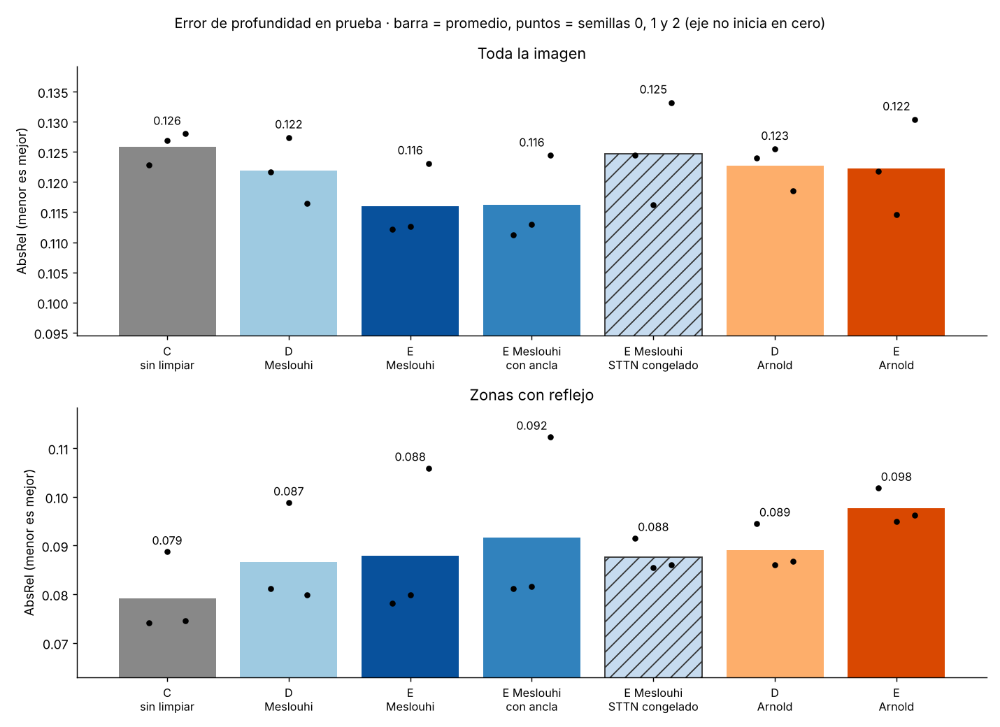
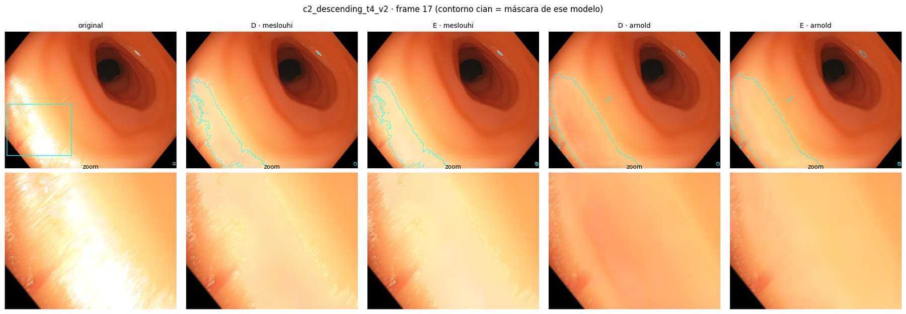
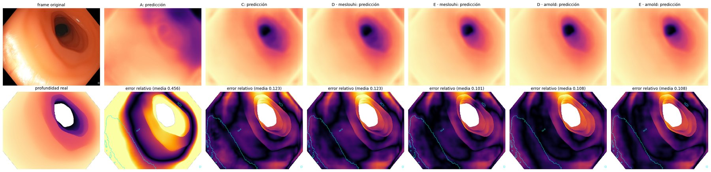

# Avance 5 · Resultados end-to-end: 3 semillas, dos máscaras y controles

**Resultado principal.** El modelo **end-to-end con la máscara El Meslouhi (E · Meslouhi)** tiene el menor error de
profundidad en la imagen completa: AbsRel **0.116 ± 0.006** en promedio de 3 semillas. El pipeline por separado (D)
tiene 0.122 y el estimador ajustado sin limpiar reflejos (C) tiene 0.126. Tres hallazgos lo sostienen:

1. **El Meslouhi es mejor máscara que Arnold para el end-to-end.** Gana en las 3 semillas. Con Arnold, el end-to-end
   no mejora a D.
2. **La ventaja viene de que Endo-STTN siga aprendiendo.** Un control con el mismo entrenamiento, pero con Endo-STTN
   congelado, pierde la mejora (0.125). Un ajuste pequeño del relleno es suficiente: con un ancla que lo limita a
   menos de 2/255 de cambio, la mejora se conserva completa.
3. **Hay dos limitaciones.** El end-to-end varía entre semillas (en la semilla 2 pierde contra D). Y en las zonas
   con reflejo ningún modelo mejora a C.

## Qué se comparó

| Modelo | Inpainting (Endo-STTN) | Estimador de profundidad (AF-SfMLearner) |
|---|---|---|
| **A** | ninguno | original (SCARED), sin ajustar |
| **C** | ninguno | ajustado con los frames originales |
| **D** | reentrenado y **congelado**: limpia los frames una vez antes de entrenar | ajustado con los frames limpios |
| **E** | reentrenado y **sigue aprendiendo** junto con el estimador | ajustado al mismo tiempo (**end-to-end**) |
| E · ancla | como E, más una pérdida que mantiene el relleno cerca del Endo-STTN congelado (`PESO_ANCLA = 0.5`) | como E |
| E · STTN congelado (control) | **congelado** (`LR_STTN = 0`), pero se usa dentro del ciclo de E | como E: clips de 5 frames, lote 2, mismo aumento de brillo |

D y E se entrenaron con cada máscara de reflejos. Cada máscara usa su propio Endo-STTN reentrenado (Avance 4):
El Meslouhi con la corrida 4 y Arnold con la variación A1 (`gen_00007`, iteración 1750). Los dos controles solo se
corrieron con El Meslouhi. Cada configuración se repitió con **3 semillas (0, 1 y 2)**. Entre corridas de una misma
comparación solo cambia la semilla o el parámetro indicado.

## Resultados en prueba (AbsRel, menor es mejor)

Prueba: `c2_descending_t4_v2` y `c2_descending_t4_v3` (52 frames), videos que ningún modelo vio al entrenar.
"Zonas con reflejo" es la unión de las máscaras El Meslouhi y Arnold en cada frame.

### Promedio de las 3 semillas

| Modelo | Toda la imagen | Zonas con reflejo |
|---|---|---|
| A · sin ajustar | 0.396 | 0.814 |
| C · sin limpiar | 0.126 ± 0.003 | **0.079 ± 0.008** |
| D · Meslouhi | 0.122 ± 0.006 | 0.087 ± 0.011 |
| **E · Meslouhi** | **0.116 ± 0.006** | 0.088 ± 0.016 |
| E · Meslouhi con ancla | **0.116 ± 0.007** | 0.092 ± 0.018 |
| E · Meslouhi con STTN congelado | 0.125 ± 0.009 | 0.088 ± 0.003 |
| D · Arnold | 0.123 ± 0.004 | 0.089 ± 0.005 |
| E · Arnold | 0.122 ± 0.008 | 0.098 ± 0.004 |

± = desviación estándar entre semillas.

### Por semilla

| Modelo | Imagen s0 | Imagen s1 | Imagen s2 | Reflejos s0 | Reflejos s1 | Reflejos s2 |
|---|---|---|---|---|---|---|
| C | 0.1228 | 0.1269 | 0.1280 | 0.0741 | 0.0887 | 0.0745 |
| D · Meslouhi | 0.1217 | 0.1274 | **0.1165** | 0.0811 | 0.0988 | 0.0799 |
| E · Meslouhi | 0.1121 | **0.1126** | 0.1231 | 0.0781 | 0.0799 | 0.1059 |
| E · Meslouhi con ancla | **0.1112** | 0.1130 | 0.1244 | 0.0812 | 0.0816 | 0.1123 |
| E · Meslouhi con STTN congelado | 0.1245 | 0.1162 | 0.1332 | 0.0915 | 0.0854 | 0.0861 |
| D · Arnold | 0.1240 | 0.1255 | 0.1185 | 0.0945 | 0.0860 | 0.0868 |
| E · Arnold | 0.1218 | 0.1146 | 0.1304 | 0.1018 | 0.0950 | 0.0962 |

Al repetir las corridas en carpetas nuevas, C y D se reentrenaron desde cero y reprodujeron sus valores con
diferencias de 0.0003 o menos. Las corridas son reproducibles. Datos completos en
[`abs_rel_por_semilla.csv`](abs_rel_por_semilla.csv).

### Pruebas de Wilcoxon pareadas por frame (toda la imagen)

| Comparación | Semilla 0 | Semilla 1 | Semilla 2 |
|---|---|---|---|
| ¿E · Meslouhi mejora a D · Meslouhi? | Sí (p = 2×10⁻¹⁰) | Sí (p = 2×10⁻⁹) | No (p = 1) |
| ¿E · Meslouhi con ancla mejora a D? | Sí (p = 2×10⁻¹⁰) | Sí (p = 2×10⁻⁹) | No (p = 1) |
| ¿E con STTN congelado mejora a D? | No (p = 0.98) | Sí (p = 3×10⁻⁹) | No (p = 1) |
| ¿E · Arnold mejora a D · Arnold? | No (p = 0.16) | Sí (p = 3×10⁻⁷) | No (p = 1) |
| E · Meslouhi contra E · Arnold (bilateral) | Meslouhi mejor (p = 1×10⁻⁷) | Meslouhi mejor, no significativo (p = 0.08) | Meslouhi mejor (p = 5×10⁻⁹) |
| D · Meslouhi contra D · Arnold (bilateral) | Sin diferencia (p = 0.51) | Sin diferencia (p = 0.05) | Sin diferencia (p = 0.20) |

## Qué muestran los resultados

1. **El Meslouhi es la mejor máscara para el end-to-end.** E · Meslouhi tiene menos error que E · Arnold en las 3
   semillas, con diferencia significativa en 2 de ellas. Con el pipeline por separado (D) las dos máscaras quedan
   prácticamente igual, así que la ventaja aparece solo cuando las redes se entrenan juntas. Con Arnold, el
   end-to-end no aporta: E · Arnold (0.122) queda igual que D · Arnold (0.123). Arnold marca mucha más área como
   reflejo (5.6–9.1 % de los píxeles de prueba contra 1.5–2.1 % de El Meslouhi), y el end-to-end cambia más su
   relleno (10–13/255 contra 5–6/255 en el frame de ejemplo).

2. **La mejora requiere que Endo-STTN siga aprendiendo.** El control con Endo-STTN congelado usa exactamente el mismo
   ciclo de entrenamiento que E (clips de 5 frames, lote de 2, mismo aumento de brillo). Solo cambia que el relleno
   no se actualiza (cambio medido: 0.0/255). Ese control queda en 0.125, al nivel de D y de C, y es peor que E en las
   3 semillas (0.1245 contra 0.1121, 0.1162 contra 0.1126 y 0.1332 contra 0.1231). Por lo tanto, la ventaja de E no
   viene de entrenar el estimador por clips. Viene de ajustar Endo-STTN durante el entrenamiento conjunto.

3. **Basta un ajuste pequeño del relleno.** Con `PESO_ANCLA = 0.5`, el relleno de E cambia solo 1.6–1.8/255
   respecto al Endo-STTN congelado, la tercera parte que sin ancla, y el error queda igual (0.116). El ancla no
   redujo la variación entre semillas.

4. **Pregunta abierta: qué parte del ajuste ayuda.** Endo-STTN se ajusta con dos señales: el error de profundidad y
   la reconstrucción de tejido sano en un hueco desplazado (`PESO_HUECO = 1.0`). Esta segunda pérdida baja de unos
   0.035 con Endo-STTN congelado a unos 0.017 cuando aprende, es decir, sigue mejorando el relleno con imágenes de
   C3VDv2. Con estos experimentos no se puede separar cuánto aporta cada señal. El control que lo resolvería es
   E con `PESO_HUECO = 0`.

5. **El end-to-end todavía es inestable.** En la semilla 2, todas las variantes de E quedan peor que D, y ya lo son
   en validación (por ejemplo, 0.0945 contra 0.0864 con ancla). No es solo un problema de elegir mal el punto de
   control. La validación tiene 45 frames con muy pocos reflejos, lo que probablemente contribuye a esta variación.

6. **En las zonas con reflejo, limpiar todavía no ayuda.** C (sin limpiar) tiene el menor error en esas zonas en
   promedio. El relleno mejora la profundidad en la imagen en general, pero no justo debajo de los reflejos.

*Frame 17 de `c2_descending_t4_v2`, semilla 1. El contorno cian es la máscara de cada modelo.*

*Mismo frame. Arriba: profundidad estimada. Abajo: error relativo (más oscuro = menos error).*

## Configuración

- Notebook: [`../notebooks/Equipo19_EndToEnd_Mascaras_colab.ipynb`](../notebooks/Equipo19_EndToEnd_Mascaras_colab.ipynb).
  Solo se cambiaron la máscara, la semilla, las rutas de Google Drive y, en los controles, `PESO_ANCLA` o `LR_STTN`.
  Las salidas de la semilla 0 sin controles están en
  [`Equipo19_EndToEnd_Mesouhi.ipynb`](../notebooks/Equipo19_EndToEnd_Mesouhi.ipynb) y
  [`Equipo19_EndToEnd_Arnold.ipynb`](../notebooks/Equipo19_EndToEnd_Arnold.ipynb).
- División (la del Avance 4): entrenamiento `c2_cecum_t1_v1`, `c2_rectum_t1_v1`, `c2_transverse1_t1_v1`,
  `c1_ascending_t3_v1`; validación `c2_sigmoid_t3_v2`; prueba `c2_descending_t4_v2`, `c2_descending_t4_v3`.
  Se toma 1 de cada 5 frames: 225 de entrenamiento, 45 de validación y 52 de prueba.
- 15 épocas para C, D y E. Lote de 8 frames para C y D, y de 2 clips de 5 frames para E. LR 1e-4 para el decoder de
  profundidad y 1e-5 para su encoder. Endo-STTN usa 1e-5, o 0 en el control congelado. `PESO_HUECO = 1.0` y
  `PESO_ANCLA = 0.0`, salvo en el control con ancla. Endo-STTN completo entrenable (`STTN_CAPAS = "todo"`). En cada
  modelo se guarda la época con menor AbsRel de validación.
- GPU NVIDIA L4 (Colab Pro). E tarda unos 19 s por época.

| Corridas | Carpeta de salida en Drive | Cambio respecto a la configuración base |
|---|---|---|
| D y E, ambas máscaras, semilla 0 | `end_to_end_mascaras` | ninguno |
| D y E, ambas máscaras, semillas 1 y 2 | carpeta propia de esas corridas | ninguno |
| E · Meslouhi con ancla, semillas 0–2 | `end_to_end_ancla05` | `PESO_ANCLA = 0.5` |
| E · Meslouhi con STTN congelado, semillas 0–2 | `end_to_end_sttn_congelado` | `LR_STTN = 0` |

## Limitaciones

- **Un solo segmento de prueba** (52 frames de `c2_descending_t4`). Hay que confirmar en videos nuevos.
- **Validación pequeña:** 45 frames con muy pocos reflejos (0.2–0.7 % de los píxeles) para elegir el punto de
  control.
- **Solo 3 semillas.** La diferencia E · Meslouhi contra D · Meslouhi (0.116 contra 0.122) es del mismo orden que la
  variación entre algunas semillas. Las conclusiones sobre la máscara y sobre el control congelado son más sólidas que
  la de E contra D.
- **La profundidad de referencia** es la de C3VDv2 (render del modelo 3D), no una medición física directa.

## Siguientes pasos

1. **Máscaras con SAM** (`SAM_prueba/`): medir si SAM detecta mejor los reflejos antes de reentrenar con sus máscaras.
2. **Probar en videos nuevos**, no usados en ninguna corrida, y con más frames de validación.
3. **Control opcional `PESO_HUECO = 0`**, para saber si la mejora de E viene del error de profundidad o de la
   reconstrucción de tejido sano.
