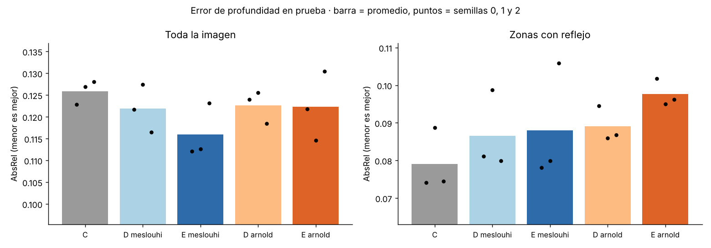
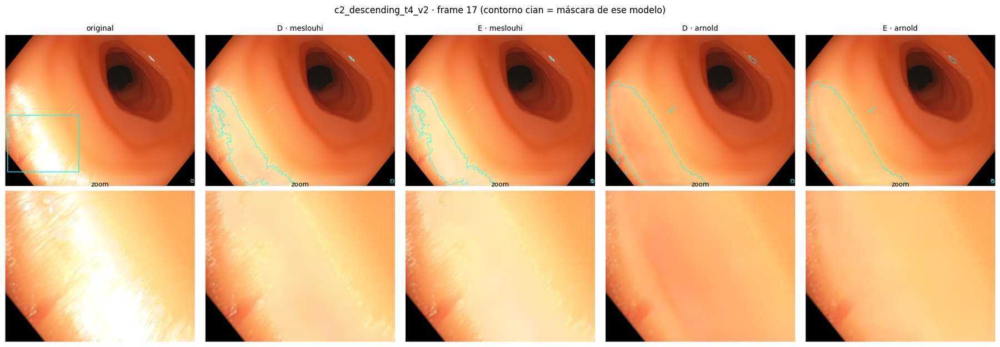
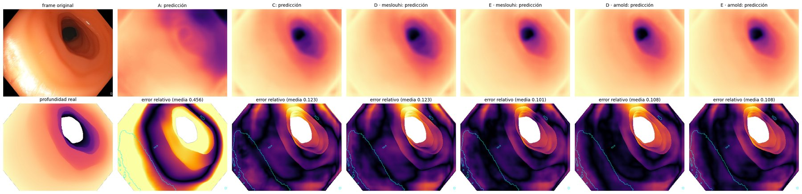

# Avance 5 · Resultados end-to-end con 3 semillas

**Resultado principal.** El modelo **end-to-end con la máscara El Meslouhi (E · Meslouhi)** tiene el menor error de
profundidad en la imagen completa: AbsRel **0.116 ± 0.006** en promedio de 3 semillas, contra 0.126 del estimador
ajustado sin limpiar reflejos (C). En las 3 semillas le gana al end-to-end con Arnold. Con Arnold, entrenar
end-to-end no mejora al pipeline por separado (D). Hay dos salvedades. El end-to-end varía mucho entre semillas: en
la semilla 2 queda peor que D con las dos máscaras. Y en las zonas con reflejo ningún modelo mejora a C.

## Qué se comparó

| Modelo | Inpainting (Endo-STTN) | Estimador de profundidad (AF-SfMLearner) |
|---|---|---|
| **A** | ninguno | original (SCARED), sin ajustar |
| **C** | ninguno | ajustado con los frames originales |
| **D** | reentrenado y **congelado**: limpia los frames una vez | ajustado con los frames limpios |
| **E** | reentrenado y **sigue aprendiendo** junto con el estimador | ajustado al mismo tiempo (**end-to-end**) |

D y E se entrenaron con cada máscara de reflejos. Cada máscara usa su propio Endo-STTN reentrenado (Avance 4):
El Meslouhi con la corrida 4 y Arnold con la variación A1 (`gen_00007`, iteración 1750). Cada combinación se repitió
con **3 semillas (0, 1 y 2)**, con la misma configuración. Solo cambia la semilla.

## Resultados en prueba (AbsRel, menor es mejor)

Prueba: `c2_descending_t4_v2` y `c2_descending_t4_v3` (52 frames), videos que ningún modelo vio al entrenar.
"Zonas con reflejo" es la unión de las máscaras El Meslouhi y Arnold en cada frame.

### Promedio de las 3 semillas

| Modelo | Toda la imagen | Zonas con reflejo |
|---|---|---|
| A · sin ajustar | 0.396 | 0.814 |
| C · sin limpiar | 0.126 ± 0.003 | **0.079 ± 0.008** |
| D · Meslouhi | 0.122 ± 0.006 | 0.087 ± 0.011 |
| **E · Meslouhi** | **0.116 ± 0.006** | 0.088 ± 0.016 |
| D · Arnold | 0.123 ± 0.004 | 0.089 ± 0.005 |
| E · Arnold | 0.122 ± 0.008 | 0.098 ± 0.004 |

± = desviación estándar entre semillas.

*El eje vertical no empieza en cero, para que se distingan las diferencias.*

### Por semilla

| Modelo | Imagen s0 | Imagen s1 | Imagen s2 | Reflejos s0 | Reflejos s1 | Reflejos s2 |
|---|---|---|---|---|---|---|
| C | 0.1228 | 0.1269 | 0.1280 | 0.0741 | 0.0887 | 0.0745 |
| D · Meslouhi | 0.1217 | 0.1274 | **0.1165** | 0.0811 | 0.0988 | 0.0799 |
| E · Meslouhi | **0.1121** | **0.1126** | 0.1231 | 0.0781 | 0.0799 | 0.1059 |
| D · Arnold | 0.1240 | 0.1255 | 0.1185 | 0.0945 | 0.0860 | 0.0868 |
| E · Arnold | 0.1218 | 0.1146 | 0.1304 | 0.1018 | 0.0950 | 0.0962 |

Datos completos en [`abs_rel_por_semilla.csv`](abs_rel_por_semilla.csv).

### Pruebas de Wilcoxon pareadas por frame (toda la imagen)

| Comparación | Semilla 0 | Semilla 1 | Semilla 2 |
|---|---|---|---|
| ¿E · Meslouhi mejora a D · Meslouhi? | Sí (p = 2×10⁻¹⁰) | Sí (p = 2×10⁻⁹) | No (p = 1) |
| ¿E · Arnold mejora a D · Arnold? | No (p = 0.16) | Sí (p = 3×10⁻⁷) | No (p = 1) |
| E · Meslouhi contra E · Arnold (bilateral) | Meslouhi mejor (p = 1×10⁻⁷) | Meslouhi mejor, no significativo (p = 0.08) | Meslouhi mejor (p = 5×10⁻⁹) |
| D · Meslouhi contra D · Arnold (bilateral) | Sin diferencia (p = 0.51) | Sin diferencia (p = 0.05) | Sin diferencia (p = 0.20) |

## Qué muestran los resultados

1. **El Meslouhi es la mejor máscara para el end-to-end.** E · Meslouhi tiene menos error que E · Arnold en las 3
   semillas, con diferencia significativa en 2 de ellas. Con el pipeline por separado (D) las dos máscaras quedan
   prácticamente igual. La ventaja aparece solo cuando las redes se entrenan juntas.
2. **Con Arnold, el end-to-end no aporta.** E · Arnold (0.122) queda igual que D · Arnold (0.123) en promedio. Además,
   el end-to-end cambia mucho más el relleno con Arnold que con El Meslouhi: diferencia media E − D dentro de los
   reflejos de 10–13/255 contra 5–6/255 en el frame de ejemplo. Arnold marca más área como reflejo (5.6–9.1 % de los
   píxeles de prueba contra 1.5–2.1 %), así que el estimador tiene más superficie inventada que "corregir".
3. **El end-to-end todavía es inestable.** Su desviación entre semillas es la mayor de la tabla. En la semilla 2,
   E queda peor que D con las dos máscaras. El punto de control se elige con solo 45 frames de validación
   (`c2_sigmoid_t3_v2`, que casi no tiene reflejos), lo que probablemente contribuye a esta variación.
4. **En las zonas con reflejo, limpiar todavía no ayuda.** C (sin limpiar) tiene el menor error en esas zonas en
   promedio. El relleno mejora la profundidad en la imagen en general, pero no justo debajo de los reflejos.

*Frame 17 de `c2_descending_t4_v2`, semilla 1. El contorno cian es la máscara de cada modelo.*

*Mismo frame. Arriba: profundidad estimada. Abajo: error relativo (más oscuro = menos error).*

## Configuración

- Notebook: [`../notebooks/Equipo19_EndToEnd_Mascaras_colab.ipynb`](../notebooks/Equipo19_EndToEnd_Mascaras_colab.ipynb),
  sin cambios salvo la máscara, la semilla y las rutas de Google Drive. Las salidas de la semilla 0 están en
  [`Equipo19_EndToEnd_Mesouhi.ipynb`](../notebooks/Equipo19_EndToEnd_Mesouhi.ipynb) y
  [`Equipo19_EndToEnd_Arnold.ipynb`](../notebooks/Equipo19_EndToEnd_Arnold.ipynb).
- División (la del Avance 4): entrenamiento `c2_cecum_t1_v1`, `c2_rectum_t1_v1`, `c2_transverse1_t1_v1`,
  `c1_ascending_t3_v1`; validación `c2_sigmoid_t3_v2`; prueba `c2_descending_t4_v2`, `c2_descending_t4_v3`.
  1 de cada 5 frames (225 de entrenamiento, 45 de validación, 52 de prueba).
- 15 épocas para C, D y E. Lote de 8 frames para C y D, y de 2 clips de 5 frames para E. LR 1e-4 para el decoder de
  profundidad (1e-5 para su encoder) y 1e-5 para Endo-STTN. `PESO_HUECO = 1.0`, `PESO_ANCLA = 0.0`, Endo-STTN
  completo entrenable (`STTN_CAPAS = "todo"`). En cada modelo se guarda la época con menor AbsRel de validación.
- GPU NVIDIA L4 (Colab Pro). E tarda unos 19 s por época.

## Limitaciones

- **Un solo segmento de prueba** (52 frames de `c2_descending_t4`). Hay que confirmar en videos nuevos.
- **Validación pequeña:** 45 frames con muy pocos reflejos (0.2–0.7 % de los píxeles) para elegir el punto de
  control.
- **Solo 3 semillas.** La diferencia E · Meslouhi contra D · Meslouhi (0.116 contra 0.122) es menor que la variación
  entre algunas semillas. La conclusión sobre la máscara es más sólida que la conclusión sobre end-to-end contra D.
- **La profundidad de referencia** es la de C3VDv2 (render del modelo 3D), no una medición física directa.

## Siguientes pasos

1. **Estabilizar el end-to-end:** repetir E · Meslouhi con `PESO_ANCLA = 0.5`, que mantiene el relleno cerca del
   Endo-STTN congelado, con las mismas 3 semillas, y comparar su desviación con la de esta tabla.
2. **Probar en videos nuevos**, no usados en ninguna corrida.
3. **Máscaras con SAM** (`SAM_prueba/`): medir si mejoran la detección antes de reentrenar.
