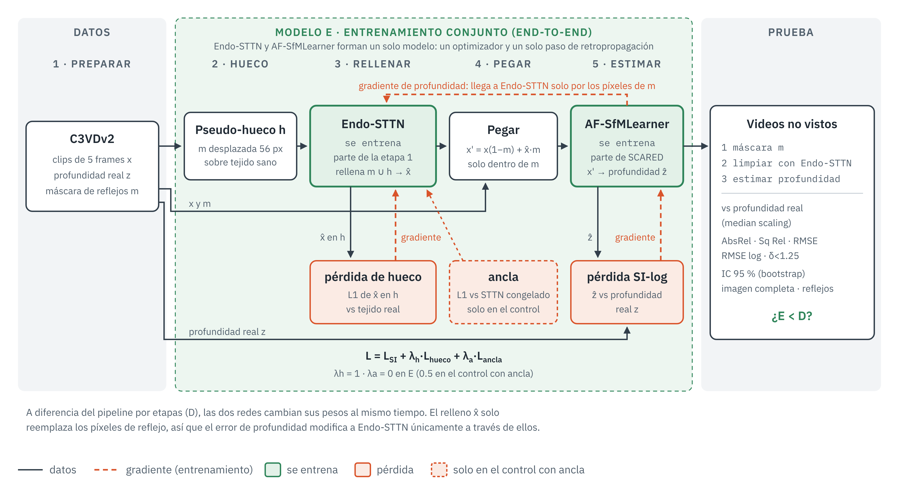

# Eliminación de reflejos especulares para mejorar la estimación de profundidad en colonoscopía

**Equipo 19** · Javier Emmanuel García Escobedo, Mario Raúl García Ramírez y Juan Miguel Molina Reyes
· Proyecto Integrador, Maestría en Inteligencia Artificial Aplicada · Asesor: Gerardo Jesús Camacho González

> **Artículo completo:** [*Entrenamiento conjunto de inpainting de reflejos y estimación de profundidad en colonoscopía*](Articulo/Entrenamiento%20conjunto%20de%20inpainting%20de%20reflejos%20y%20estimacion%20de%20profundidad%20en%20colonoscopia.pdf) (PDF)

## Qué hace este proyecto

Los reflejos especulares del video de colonoscopía ocultan tejido y confunden a los modelos que estiman la forma 3D
del colon con una sola cámara. Este proyecto elimina los reflejos con ***inpainting* temporal (Endo-STTN)** y estima
la profundidad con **AF-SfMLearner**, usando videos de fantomas de colon con profundidad de referencia
(**C3VDv2**, Johns Hopkins).

El modelo final (**E**) entrena las dos redes **juntas** (*end-to-end*): el error de profundidad también ajusta el
relleno de Endo-STTN, solo a través de los píxeles de reflejo.

## Resultado principal

Error de profundidad en prueba (`c2_descending_t4` v2 y v3, videos que ningún modelo vio). Media de 3 semillas con
intervalo de confianza del 95 % por *bootstrap* de bloques; menor es mejor, salvo δ.

| Modelo | Qué es | AbsRel | RMSE (mm) | δ < 1.25 |
|---|---|---|---|---|
| A | AF-SfMLearner (SCARED), sin ajustar | 0.396 [0.376, 0.409] | 18.38 | 0.388 |
| C | Ajustado con frames originales (sin limpiar) | 0.126 [0.112, 0.134] | 7.86 | 0.805 |
| D | Endo-STTN reentrenado y congelado; ajustado con frames limpios (por etapas) | 0.122 [0.108, 0.130] | 7.53 | 0.814 |
| **E** | **Endo-STTN y estimador entrenados juntos (máscara El Meslouhi)** | **0.116** [0.104, 0.124] | **6.75** | **0.832** |

- **E mejora a D** en la imagen completa: −0.005 de AbsRel, IC 95 % [−0.006, −0.004].
- **La mejora requiere que Endo-STTN siga aprendiendo:** con Endo-STTN congelado dentro del mismo ciclo, el error
  vuelve a 0.125.
- **No viene de un relleno visualmente mejor:** el relleno de E es igual al del Endo-STTN congelado.
- **Limitaciones:** dentro de los reflejos, ningún modelo con limpieza mejora todavía al estimador sin limpiar (C);
  la prueba es un solo segmento anatómico; y la ventaja de E depende del punto de partida del estimador
  ([prueba con Monodepth2](Avance6_Revision/README.md#prueba-adicional-punto-de-partida-del-estimador)).

## Mapa del repositorio

Cada carpeta de avance tiene su propio README con el detalle, los notebooks y los resultados.

| Carpeta | Qué se hizo | Estado |
|---|---|---|
| [`Avance1_ExploracionDatos`](Avance1_ExploracionDatos/) | Exploración de C3VDv2: formato, reflejos, residuos y redundancia entre frames | Histórico |
| [`Avance2_DeepEstimator_EndoSTTN`](Avance2_DeepEstimator_EndoSTTN/README.md) | Primer pipeline por etapas: Endo-STTN publicado limpia los frames y se ajusta AF-SfMLearner (modelos A–D) | Histórico |
| [`Avance3_ReEntrenar_Endo`](Avance3_ReEntrenar_Endo/README.md) | Reentrenamiento de Endo-STTN con C3VDv2 | Histórico |
| [`Avance4_ComparacionMascaras`](Avance4_ComparacionMascaras/README.md) | Máscaras El Meslouhi y Arnold; mejor configuración de Endo-STTN (corridas 1–5, A1–A3) | Base del modelo final |
| [`Avance5_EndtoEnd`](Avance5_EndtoEnd/README.md) | **Entrenamiento conjunto (modelo E)** con las dos máscaras y 3 semillas | **Modelo final** |
| [`Avance6_EvaluarVideo`](Avance6_EvaluarVideo/README.md) | Aplicar el modelo E a cualquier video de C3VDv2 | Uso del modelo |
| [`Avance6_Revision`](Avance6_Revision/README.md) | Pruebas pedidas en la revisión: fuga de datos, estimador solo, Endo-STTN solo, IC 95 % y punto de partida del estimador | **Validación** |
| [`SAM_prueba`](SAM_prueba/README.md) | ¿Segment Anything detecta mejor los reflejos? | Exploración |
| [`Entrenamiento_end_to_end`](Entrenamiento_end_to_end/README.md) | Primer diseño del entrenamiento conjunto, solo con datos sintéticos | Reemplazado por el Avance 5 |

Otras carpetas en la raíz:

| Carpeta | Contenido |
|---|---|
| `codigo/`, `preparar_entorno.py`, `requirements.txt` | Scripts del pipeline por etapas del Avance 2 |
| `Endo-STTN/` | Copia del repositorio original de Endo-STTN (Daher et al., 2023), código de terceros con su propia licencia |
| `datos/raw/` | Lugar para los ZIP de C3VDv2 si se trabaja en local (no se suben al repositorio) |

## Cómo correrlo

Todo se ejecuta en **Google Colab** (A100 o L4, RAM alta). Los datos de C3VDv2 y los pesos se leen de Google Drive,
no se suben al repositorio.

| Quiero… | Notebook |
|---|---|
| Entrenar los modelos C, D y E | [`Avance5_EndtoEnd/notebooks/Equipo19_EndToEnd_Mascaras_colab.ipynb`](Avance5_EndtoEnd/notebooks/Equipo19_EndToEnd_Mascaras_colab.ipynb) |
| Aplicar el modelo E a un video | [`Avance6_EvaluarVideo/notebooks/Equipo19_Avance6_Evaluar_Video_colab.ipynb`](Avance6_EvaluarVideo/notebooks/Equipo19_Avance6_Evaluar_Video_colab.ipynb) |
| Reproducir las pruebas de validación y los IC 95 % | [`Avance6_Revision/notebooks/Equipo19_Avance6_Revision_colab.ipynb`](Avance6_Revision/notebooks/Equipo19_Avance6_Revision_colab.ipynb) |

Los pesos de los modelos finales se describen en
[`Avance5_EndtoEnd/Modelos Finales`](Avance5_EndtoEnd/Modelos%20Finales/README.md).

El pipeline por etapas del Avance 2 también se puede correr en local: `python preparar_entorno.py`, después los
scripts de `codigo/` en orden; ver el [README del Avance 2](Avance2_DeepEstimator_EndoSTTN/README.md#8-cómo-reproducir).

## Referencias principales

- Daher, R., Vasconcelos, F. y Stoyanov, D. (2023). A temporal learning approach to inpainting endoscopic
  specularities and its effect on image correspondence. *Medical Image Analysis*, 90, 102994. (Endo-STTN)
- Shao, S. et al. (2022). Self-supervised monocular depth and ego-motion estimation in endoscopy: Appearance flow to
  the rescue. *Medical Image Analysis*, 77, 102338. (AF-SfMLearner)
- Golhar, M. V. et al. (2026). C3VDv2 – Colonoscopy 3D video dataset with enhanced realism. *Scientific Data*, 13,
  1273.

---

*Este proyecto se elaboró con apoyo de Claude (Anthropic) para código y documentación. Los integrantes ejecutaron los
experimentos, verificaron las cifras y son responsables del contenido.*
