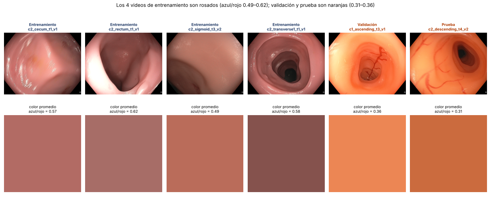
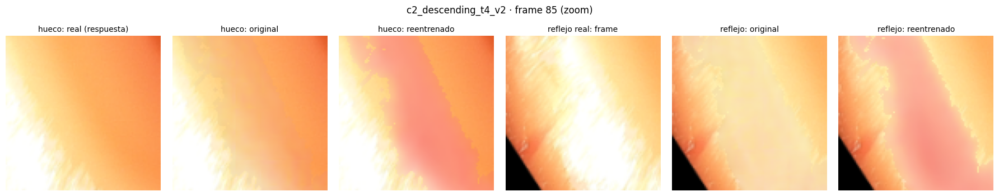
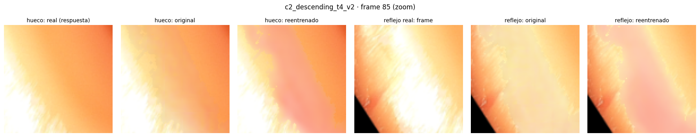
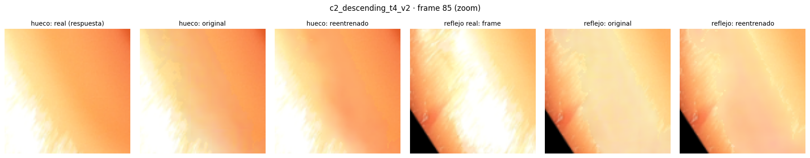
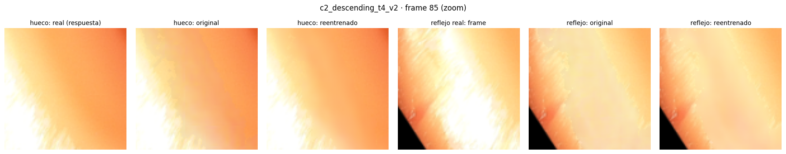

# Re-entrenamiento de Endo-STTN con C3VDv2 · Corridas con máscara El Meslouhi

**Resultado principal.** El Endo-STTN re-entrenado con C3VDv2 rellena mejor que el modelo publicado (`gen_00009.pth`)
**solo si el entrenamiento incluye tejido del mismo color que el video de prueba**. La mejor configuración
(división balanceada en color + tasa de aprendizaje 1e-5) baja el MAE de prueba de **6.66 a 4.30** (corrida 4) y
se reproduce con otra semilla (corrida 5: **4.37**). Con datos de entrenamiento de un solo color, el re-entrenado
rellena peor que el original (corridas 1 y 3).

## Resultados en prueba

Mismo conjunto de prueba en todas las corridas: `c2_descending_t4_v2` y `c2_descending_t4_v3` (250 frames medibles;
el v3 tiene residuos). Métricas dentro del hueco desplazado (*pseudo ground truth*), igual que `quantifyResults.ipynb`
de Endo-STTN. Wilcoxon pareado por frame contra el original (H1: el re-entrenado es mejor).

| Corrida | Entrenamiento | LR | Lote / GPU | Iteraciones | Semilla | Checkpoint elegido | PSNR (dB) ↑ | SSIM ↑ | MAE ↓ | ¿Mejora al original? |
|---|---|---|---|---|---|---|---|---|---|---|
| Original (`gen_00009.pth`) | HyperKvasir (autores) | — | — | — | — | — | 29.51 | 0.826 | 6.66 | Referencia |
| **4** | Balanceado | 1e-5 | 4 / L4 | 2,000 | 2020 | 1,750 | **32.52** | **0.879** | **4.30** | Sí (p < 10⁻³⁹) |
| **5** | Balanceado | 1e-5 | 4 / L4 | 2,000 | 2021 | 2,000 | 32.43 | 0.876 | 4.37 | Sí (p < 10⁻³⁹) |
| 2 | Balanceado | 1e-4 | 4 / L4 | 4,000 | 2020 | 750 | 31.67 | 0.872 | 4.75 | Sí (p < 10⁻²⁶) |
| 1 | Solo rosa | 1e-4 | 2 / T4 | 9,000 | 2020 | 1,000 | 27.18 | 0.808 | 8.68 | No (p = 1) |
| 3 | Solo rosa | 1e-4 | 4 / L4 | 2,000 | 2020 | 1,250 | 26.67 | 0.802 | 8.71 | No (p = 1) |

Frames de prueba donde el re-entrenado tiene menor MAE que el original: corrida 1, 34 de 250; corrida 3, 3 de 250;
corrida 5, 248 de 250 (corridas 2 y 4: ver `notebook_ejecutado.ipynb`).

## Qué muestran las corridas

1. **El color de los datos de entrenamiento es el factor decisivo.** Las corridas 2 y 3 usan el mismo lote, GPU,
   tasa de aprendizaje y semilla; solo cambia la división. Con un video naranja en entrenamiento (corrida 2) el
   re-entrenado mejora al original; sin él (corrida 3) empeora y rellena con tonos rosados sobre tejido naranja.
2. **Un ajuste más suave es mejor y más estable.** Con LR 1e-5 (corrida 4) todos los checkpoints quedan entre
   1.90 y 1.97 de MAE en validación, contra 2.09–2.83 con LR 1e-4 (corrida 2), en el mismo video de validación.
3. **El resultado se reproduce.** Repetir la corrida 4 con otra semilla (corrida 5) da PSNR 32.43 vs 32.52 y
   MAE 4.37 vs 4.30.



| Corrida | Relleno en un frame de prueba (c2_descending_t4_v2, frame 85) |
|---|---|
| 1 (solo rosa) |  |
| 3 (solo rosa) |  |
| 2 (balanceada, LR 1e-4) |  |
| 4 (balanceada, LR 1e-5) |  |
| 5 (balanceada, LR 1e-5, semilla 2021) |  |

## Configuración común

- Notebook: `Avance3_ReEntrenar_Endo/notebooks/Equipo19_Avance3_ReEntrenar_Endo_colab.ipynb`, con el entrenamiento
  original de Endo-STTN (`core/trainer.py`) sin modificar.
- Punto de partida: generador `gen_00009.pth`; discriminador desde cero (el modelo publicado no lo incluye).
- Máscara de reflejos: El Meslouhi (2011), dilatada 1 px (`MASCARA = "meslouhi"`).
- Clips de 5 frames a 288 × 288; pérdidas L1 en el hueco + L1 fuera del hueco + adversarial (peso 0.01); Adam,
  betas (0, 0.99).
- Para pasar la tasa de aprendizaje y la semilla se agregaron `LR` y `SEMILLA` a la celda de configuración y
  `"--lr", LR, "--semilla", SEMILLA` a la celda de entrenamiento (opciones ya existentes de `entrenar_endosttn.py`).

**Divisiones de datos**

| División | Entrenamiento | Validación | Prueba |
|---|---|---|---|
| Automática por segmento (solo rosa) · corridas 1 y 3 | c2_cecum_t1_v1, c2_rectum_t1_v1, c2_sigmoid_t3_v2, c2_transverse1_t1_v1 | c1_ascending_t3_v1 | c2_descending_t4_v2, c2_descending_t4_v3 |
| Balanceada · corridas 2, 4 y 5 | c2_cecum_t1_v1, c2_rectum_t1_v1, c2_transverse1_t1_v1, c1_ascending_t3_v1 | c2_sigmoid_t3_v2 | c2_descending_t4_v2, c2_descending_t4_v3 |

La división balanceada se fija con:

```python
DIVISION_MANUAL = {"entrenamiento": ["c2_cecum_t1_v1", "c2_rectum_t1_v1", "c2_transverse1_t1_v1", "c1_ascending_t3_v1"],
                   "validacion": ["c2_sigmoid_t3_v2"],
                   "prueba": ["c2_descending_t4_v2", "c2_descending_t4_v3"]}
```

## Limitaciones

- **Un solo segmento de prueba** (c2_descending_t4). Como se usó para comparar corridas, la configuración ganadora
  debe confirmarse en un video naranja nuevo que no se haya usado en ninguna corrida.
- **Validación pequeña en la división balanceada:** c2_sigmoid_t3_v2 casi no tiene reflejos; solo 53 de 225 frames
  tienen un hueco medible.
- **La métrica mide tejido sano:** el hueco desplazado cae sobre tejido sin reflejo; debajo de un reflejo real el
  tejido puede ser distinto.
- **Las validaciones no son comparables entre divisiones** (cambia el video); la comparación entre corridas se hace
  en prueba.
- **Comparación con otros métodos de máscara:** el hueco de evaluación se construye desplazando la máscara del
  propio método, así que estos números no se comparan directamente con corridas que usan otra máscara (por ejemplo,
  Arnold). Para una comparación justa hay que evaluar ambos modelos sobre los mismos huecos y la misma división.

## Contenido de cada carpeta

| Archivo | Contenido |
|---|---|
| `resumen.md` | Configuración, resultados en prueba, Wilcoxon y validación por checkpoint (salida de `evaluar_endosttn.py`) |
| `validacion_por_checkpoint.csv` | PSNR, SSIM y MAE en validación del original y de cada checkpoint |
| `prueba_por_frame.csv` | PSNR, SSIM y MAE de cada frame de prueba, por modelo |
| `config.json` | Configuración exacta del entrenamiento (GPU, fecha, lote, LR, semilla, división) |
| `mejor.json` | Checkpoint elegido por validación |
| `revision_mascaras.png` | 50 frames de entrenamiento al azar con su máscara |
| `notebook_ejecutado.ipynb` | Notebook de Colab con todas las salidas y figuras |

En las corridas 2 y 4, `resumen.md` se tomó de la salida del notebook ejecutado; sus archivos CSV y JSON están en
Google Drive. Los modelos (`gen_mejor.pth`, unos 66 MB) no se suben al repositorio; quedan en Google Drive, en la
carpeta de cada corrida (`modelos/gen_mejor.pth`).

## Siguientes pasos

1. Confirmar la configuración de la corrida 4 en un video naranja nuevo, no usado en ninguna corrida.
2. Comparar contra las corridas con máscara Arnold sobre los mismos huecos de evaluación.
3. Limpiar los frames con el `gen_mejor.pth` de la corrida 4 y ajustar el estimador de profundidad, para medir si
   el mejor relleno también mejora la profundidad respecto al modelo D del Avance 2.
